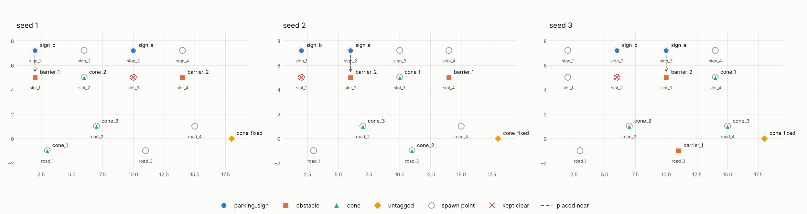
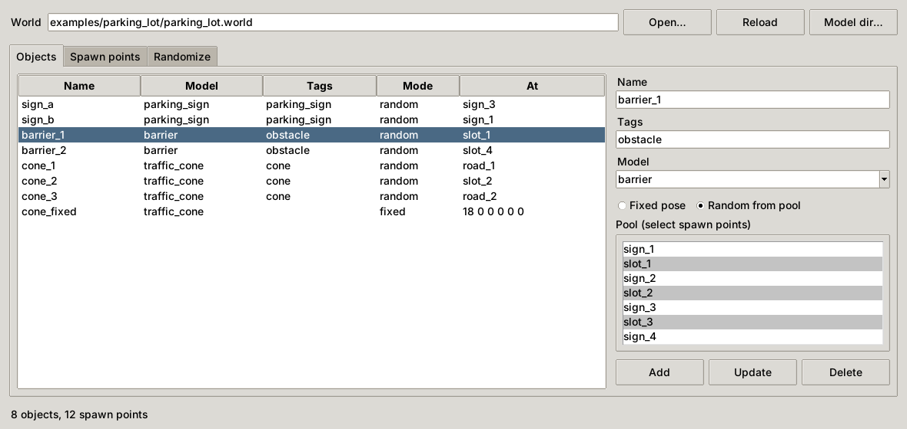

# gazebo-object-injector

Adds models to a Gazebo world file and moves them between named spawn points,
so every simulation run starts from a different layout that still follows
your scenario's rules. The output is a plain SDF world. No plugin is needed.

<picture>
  <source media="(prefers-color-scheme: dark)" srcset="docs/preview-dark.png">
  
</picture>

*The same parking lot randomized with three seeds: one barrier in front of one
parking sign, the slot in front of the other sign kept empty.*

## Usage

Needs Python 3.8+ and PyYAML. The editor window needs tkinter, and the
`preview` command needs matplotlib.

```bash
sudo apt install python3-yaml python3-tk python3-matplotlib

python3 gazebo_object_injector.py track.world                     # editor window
python3 gazebo_object_injector.py randomize track.world --seed 7  # new layout
python3 gazebo_object_injector.py --help                          # all commands
```



The same operations are available from the command line:

```bash
python3 gazebo_object_injector.py spawn track.world set slot_1 2 5 0          # x y z [roll pitch yaw]
python3 gazebo_object_injector.py add track.world barrier_1 barrier --pool slot_1,slot_2 --tags obstacle
python3 gazebo_object_injector.py add track.world start box --pose 0 0 0      # fixed object
python3 gazebo_object_injector.py randomize track.world -o /tmp/run.world     # source file stays as is
```

The same seed always gives the same layout, so a failing run can be
reproduced. Without `--seed`, a new seed is picked and printed.

## Rules

Without rules, each random object goes to a free spawn point from its own
pool, with one object per spawn point. Relations between objects go in a YAML
file, passed with `--rules` or placed next to the world as
`track.rules.yaml`:

```yaml
rules:
  - id: blocked_slot
    near:                    # an obstacle on the spawn point closest to a parking sign
      objects: {tag: obstacle}
      targets: {tag: parking_sign}
      max_distance: 3.0
  - keep_clear:              # nothing within 3 m of the other signs
      targets: {tag: parking_sign}
      except: [blocked_slot]
      radius: 3.0
```

Selectors match on `tag`, `name` or `model`. `name` and `model` accept
patterns such as `construction_*`. An object that finds no free spawn point is
left out of the world for that run.

## How it edits the file

Spawn points and objects are written between marker comments. Everything else
in the world file is left untouched, so it can still be edited by hand.

```xml
<!-- [object-injector:barrier_1] -->
<!-- META: uri=barrier | random=True | spawns=slot_1,slot_2 | tags=obstacle | at=slot_1 -->
<include>
  <name>barrier_1</name>
  <uri>model://barrier</uri>
  <pose>2 5 0 0 0 0</pose>
</include>
<!-- [/object-injector:barrier_1] -->
```

Placement only checks spawn points; it does not know model sizes. Leave
enough room between spawn points for the largest object that can use them.

## License

Apache-2.0
